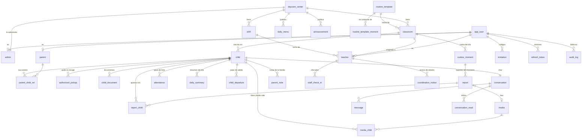

# Datos de prueba (servidor compartido `codeaapp.site`)

Qué hay en la base, quién es quién y con qué cuenta entrar para probar cada pantalla. Los datos los pone
[`guarderia-api/app/seed_demo.py`](../guarderia-api/app/seed_demo.py), que **borra toda la base y todas las fotos
del bucket** y vuelve a llenar las tablas. **Por ahora va sin fotos** (decisión del 19/oct): `media`, `media_child` y
`media_deletion_request` quedan vacías, igual que los campos de foto o imagen de reportes, avisos, chat y documentos. Con
`--con-fotos` se llenan también (imágenes de colores generadas, 1200 × 900) y ninguna columna queda vacía. Las fechas se calculan
el día en que se corre: «hoy» es ese día y la historia son los 10 días hábiles anteriores.

## Cómo entrar

- App: `API_BASE_URL=https://api.codeaapp.site/api/v1/` en `local.properties` (ver [`GUIA-CONTINUAR.md`](GUIA-CONTINUAR.md)).
- **Todas las cuentas usan la misma contraseña.** No se escribe aquí porque el repo es público: pídela en el grupo del equipo.
- Usa una cuenta distinta a la de tus compañeros: si dos personas usan la misma docente, se pisan el check-in y la rutina del día.

## Cuentas

### Administración

| Correo | Nombre | Notas |
|---|---|---|
| `admin@oruga.test` | Dirección La Oruga | Único admin del centro «La Oruga» |

### Docentes

| Correo | Nombre | Sala | Principal | Turno |
|---|---|---|---|---|
| `fernando.rios@oruga.test` | Fernando Ríos | Maternal | ✅ | Matutino |
| `karla.vega@oruga.test` | Karla Vega | Maternal | | Matutino |
| `gabriela.ortiz@oruga.test` | Gabriela Ortiz | Preescolar 1 | ✅ | Matutino |
| `andres.cano@oruga.test` | Andrés Cano | Preescolar 1 | | Vespertino |
| `paola.sanchez@oruga.test` | Paola Sánchez | Preescolar 2 | ✅ | Matutino |
| `karla.robles@oruga.test` | Karla Robles | Preescolar 2 | | Matutino |
| `luis.medina@oruga.test` | Luis Medina | Preescolar 2 | | Vespertino |
| `monica.salinas@oruga.test` | Mónica Salinas | (sin sala) | | Matutino |

Mónica Salinas está **dada de baja**: al entrar responde «Tu acceso a la app está desactivado». Sirve para probar las bajas y la reactivación desde el admin.

### Familias (padres)

| Correo | Nombre | Hijos (sala) | Parentesco |
|---|---|---|---|
| `laura.iglesias@oruga.test` | Laura Iglesias | **Ana (Maternal) y Mateo (Preescolar 2)** | Mamá, tutora principal |
| `hector.iglesias@oruga.test` | Héctor Iglesias | **Ana (Maternal) y Mateo (Preescolar 2)** | Papá |
| `andrea.torres@oruga.test` | Andrea Torres | **Emiliano (Preescolar 1) y Regina (Preescolar 2)** | Mamá, tutora principal |
| `ricardo.torres@oruga.test` | Ricardo Torres | **Emiliano (Preescolar 1) y Regina (Preescolar 2)** | Papá |
| `carlos.gomez@oruga.test` | Carlos Gómez | Renata (Maternal) | Papá, tutor principal |
| `daniela.perez@oruga.test` | Daniela Pérez | Renata (Maternal) | Mamá |
| `marisol.hernandez@oruga.test` | Marisol Hernández | Diego (Maternal) | Mamá |
| `rosa.trevino@oruga.test` | Rosa Treviño | Leo Martínez (Maternal) | Tutora legal (abuela) |
| `jorge.flores@oruga.test` | Jorge Flores | Camila (Preescolar 1) | Papá |
| `elena.marquez@oruga.test` | Elena Márquez | Sofía (Preescolar 1) | Mamá |
| `miguel.cantu@oruga.test` | Miguel Cantú | Santiago (Preescolar 1) | Papá |
| `sofia.ruiz@oruga.test` | Sofía Ruiz | Valentina (Preescolar 2) | Otro (tía) |
| `patricia.ramirez@oruga.test` | Patricia Ramírez | Lucía (Preescolar 2) | Mamá |

Para probar **varios hijos en la misma app** (selector de hijo), entra con una cuenta de las familias Iglesias o Torres.

## Centro y salas

- **Centro «La Oruga»** (Monterrey, `America/Monterrey`): entrada 8:00, salida 16:00, cierre automático de entradas abiertas 21:00, de lunes a viernes. Turnos: Matutino (8:00–16:00) y Vespertino (12:00–20:00).
- **Rutinas:** «Día completo · Preescolar» (la de por omisión) y «Día completo · Maternal». Las dos tienen 9 momentos.

| Sala | Grado | Cupo | Rutina | Docentes | Niños |
|---|---|---|---|---|---|
| Maternal | Maternal (1 a 3 años) | 10 | Día completo · Maternal | Fernando Ríos (principal), Karla Vega | Ana Iglesias, Renata Gómez, Diego Hernández, Leo Martínez |
| Preescolar 1 | 1° de preescolar | 12 | Día completo · Preescolar | Gabriela Ortiz (principal), Andrés Cano | Emiliano Torres, Camila Flores, Sofía Márquez, Santiago Cantú |
| Preescolar 2 | 2° de preescolar | 12 | Día completo · Preescolar | Paola Sánchez (principal), Karla Robles, Luis Medina | Mateo Iglesias, Valentina Ruiz, Regina Torres, Lucía Ramírez |
| Lactantes | Lactantes (0 a 1 año) | 8 | Día completo · Maternal | — | — (**sala archivada**, `deleted_at` puesto) |

Momentos de cada rutina:

| # | Preescolar | Maternal |
|---|---|---|
| 1 | Recepción y bienvenida (8:00) | Recepción y bienvenida (8:00) |
| 2 | Desayuno (8:30) | Desayuno (8:30) |
| 3 | Trazos y motricidad (9:15) | Estimulación temprana (9:15) |
| 4 | Patio y juego libre (10:30) | Juego sensorial (10:15) |
| 5 | Comida (12:30) | Comida (12:00) |
| 6 | Siesta (13:15) | Siesta (12:45) |
| 7 | Higiene y cambio (14:20) | Cambio de pañal (14:20) |
| 8 | Actividad de la tarde (14:45) | Música y cuentos (14:45) |
| 9 | Entrega a familias (15:30) | Entrega a familias (15:30) |

## Niños

| Niño | Nacimiento | Sala | Tutores (app) | Personas autorizadas (sin cuenta) | Salud (lo que ve la docente) |
|---|---|---|---|---|---|
| Ana Iglesias | 14/09/2024 | Maternal | Laura (mamá, principal), Héctor (papá) | Carmen Iglesias (abuela) | Intolerante a la lactosa; usa chupón para dormir |
| Renata Gómez | 20/02/2024 | Maternal | Carlos (papá, principal), Daniela Pérez (mamá) | Gloria Pérez (abuela) | Alergia a la penicilina; dermatitis atópica leve; crema hidratante |
| Diego Hernández | 15/01/2025 | Maternal | Marisol (mamá) | Tomás Hernández (tío), Lupita Garza (niñera) | Huevo en observación; dejando el biberón |
| Leo Martínez | 03/06/2024 | Maternal | Rosa Treviño (tutora legal) | Alberto Treviño (tío abuelo) | Alergia a picadura de abeja; vive con su abuela |
| Emiliano Torres | 02/04/2023 | Preescolar 1 | Andrea (mamá, principal), Ricardo (papá) | Luis Torres (abuelo) | Alergia al cacahuate; asma leve; salbutamol en la mochila |
| Camila Flores | 12/06/2023 | Preescolar 1 | Jorge (papá) | Mariana Flores (tía) | Intolerante al gluten; usa lentes |
| Sofía Márquez | 25/09/2023 | Preescolar 1 | Elena (mamá) | Raúl Márquez (papá, no vive con ella) | Alergia a la fresa; zurda |
| Santiago Cantú | 08/03/2023 | Preescolar 1 | Miguel (papá) | Ana Cantú (tía) | Terapia de lenguaje los martes |
| Mateo Iglesias | 10/05/2022 | Preescolar 2 | Laura (mamá, principal), Héctor (papá) | Carmen Iglesias (abuela) | Sin alergias; hermano mayor de Ana |
| Valentina Ruiz | 30/08/2022 | Preescolar 2 | Sofía Ruiz (tía) | Pedro Ruiz (tío) | Alergia a mariscos |
| Regina Torres | 20/01/2022 | Preescolar 2 | Andrea (mamá, principal), Ricardo (papá) | Luis Torres (abuelo) | Vitaminas en casa; hermana mayor de Emiliano |
| Lucía Ramírez | 18/04/2022 | Preescolar 2 | Patricia (mamá) | Jesús Ramírez (abuelo) | Alergia al polen; rinitis; loratadina en temporada |

Cada niño tiene dos documentos: el **acta de nacimiento** (subida solo con `--con-fotos`) y la **cartilla de vacunación pendiente**, que vence en dos semanas.

## Qué hay en cada día

**Historia (los 10 días hábiles anteriores, las tres salas):**
- **Checador:** entrada de cada docente entre 7:40 y 8:08. Si llegó después de las 8:00 queda con retardo, motivo y aviso a coordinación. La salida queda entre 16:00 y 16:35. Un día, la última docente de cada sala tiene la salida puesta por el cierre automático de las 21:00.
- **Pase de lista:** alrededor del 10 % de faltas al azar. Los presentes tienen hora de entrada entre 7:45 y 8:25.
- **Rutina:** los 9 momentos confirmados, con hora, docente que confirmó y nota.
- **Reportes:** desayuno (logro), actividad (logro grupal de 3 niños), siesta (salud, por dictado) y patio (conducta, 2 niños). Hay **incidentes** en dos días (rodilla raspada).
- **Fotos:** ninguna por ahora. Con `--con-fotos`, los reportes de comidas, actividades e incidentes de los **últimos 6 días** llevan foto etiquetada con los niños del reporte.
- **Resumen del día** de cada niño presente (ánimo, comida, cambios de pañal y siesta) y **pase de salida** (hora y quién lo recogió: un tutor o una persona autorizada).

**Hoy:**
- **Maternal va a medio día:** pase de lista hecho, momentos 1 a 3 confirmados, el 4 (Juego sensorial) en curso y reportes del desayuno y de la estimulación. Fernando y Karla Vega checaron entrada sin salida. Todavía no hay resúmenes ni salidas.
- **Preescolar 1 y 2 no han empezado:** nadie ha checado ni pasado lista. Sirven para probar el flujo de la docente desde cero.

**Lo demás:**
- **Menú del día:** todos los días hábiles, desde el primer día de la historia hasta dos semanas después de hoy.
- **Avisos:** dos para todo el centro (Festival de Otoño y junta de padres) y uno por sala (museo para Preescolar 2; pañales para Maternal; colores para Preescolar 1).
- **Chat:** uno por niño, entre su tutor principal y la docente principal de su sala. Tiene 6 mensajes de los últimos 3 días; los dos últimos son del último día hábil y la familia todavía no los ha leído.
- **Notas de la familia:** ayer, una de cada niño, ya leída por la docente. Hoy, una sin leer en la mitad de los niños.
- **Historial de fotos borradas** (solo con `--con-fotos`): una solicitud aprobada, una rechazada y una foto que borró la familia directamente.
- **Cuentas:** todas activadas. Marisol Hernández tuvo una recuperación de contraseña. La bitácora de auditoría tiene altas, activaciones, logins, intentos fallidos y cambios.

## Cómo se relacionan las tablas



En palabras:
- **Una cuenta (`app_user`) tiene un rol** según la tabla donde aparece: `admin`, `teacher` o `parent`. El correo y la contraseña viven en `app_user`.
- **Padre ↔ hijo** es muchos a muchos (`parent_child_rel`), con parentesco y tutor principal. Un niño puede tener varios tutores (Iglesias, Gómez, Torres) y un tutor varios niños (Iglesias, Torres).
- **Docente → sala** es una sala por docente (`teacher.classroom_id`) con una sola principal por sala. **Niño → sala** es igual (`child.classroom_id`). La docente ve a los niños de su sala, y el chat de un niño lo ven sus tutores y las docentes de su sala.
- Las **personas autorizadas** (`authorized_pickup`) no tienen cuenta: son nombres con teléfono que salen en el pase de salida junto con los tutores.
- La **rutina del día** (`routine_moment`) se copia de la plantilla de la sala la primera vez que alguien la abre ese día. Los **reportes** cuelgan de un momento y se etiquetan a uno o varios niños (`report_child`). La foto del reporte es un `media` etiquetado a los mismos niños (`media_child`): eso decide qué familias la ven y en qué categoría (Comidas, Siesta, Incidentes o Actividades).
- Cada niño tiene **un registro por día** en `attendance` (pase de lista y hora de entrada), `daily_summary` (lo que ve la familia en Hoy) y `child_departure` (pase de salida).

## Volver a generar los datos

En la Mac que corre el servidor, dentro de `guarderia-api/`:

```
docker compose -p codea-prod --env-file .env.prod -f docker-compose.yml -f docker-compose.prod.yml \
  exec -T -e SEED_PASSWORD='<la contraseña del grupo>' api python - --borrar-todo < app/seed_demo.py
# agrega --con-fotos después de --borrar-todo para incluir fotos de prueba
```

Ese comando **borra todo lo que hayan creado los demás**: avisa en el grupo antes de correrlo. Fuera de desarrollo, el script se niega a usar `codea1234`.
