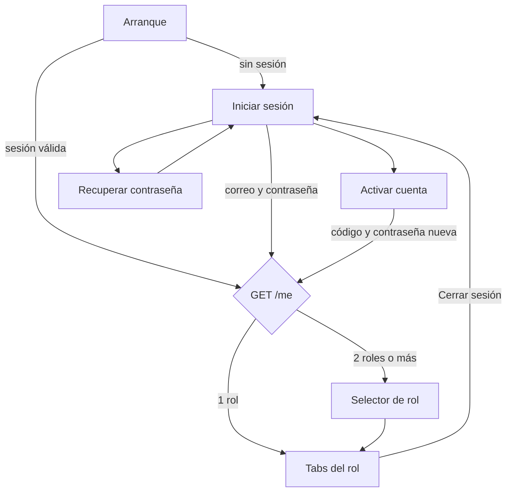

# App: pantallas para el mínimo funcional

Hoy la app tiene unas 30 pantallas en uso, pero no tiene login: abre en `RoleSelectionScreen` y manda `Bearer dev:<correo>`. Desde la primera versión de este plan se conectó a la API buena parte de las pantallas de admin (salas, docentes, infantes, padres, rutinas, avisos), de la docente (rutina de hoy, avisos) y del padre (avisos). Para que funcione de verdad faltan **7 pantallas indispensables (P0)** y **6 para entregar completo (P1)** (la de Avisos ya está hecha).

Prioridades:

- **P0:** sin esto la app no funciona con la API o un rol queda incompleto (no puede entrar, salir o chatear).
- **P1:** mínimo para entregar: completa flujos que ya se ven en pantalla pero no hacen nada.
- **P2:** después de la primera entrega.

## Pantallas nuevas

### P0: indispensables

| # | Pantalla | Rol | Para qué | Cómo se llega | Endpoints |
| --- | --- | --- | --- | --- | --- |
| 1 | **Arranque** (`SplashScreen`) | Todos | Lee la sesión guardada; si hay, pide `GET /me` y abre las tabs del rol; si no, manda a Iniciar sesión | Al abrir la app | `GET /me`, `POST /auth/refresh` |
| 2 | **Iniciar sesión** (`LoginScreen`) | Todos | Correo y contraseña. Enlaces a "Activar mi cuenta" y "¿Olvidaste tu contraseña?" | Arranque sin sesión, o al cerrar sesión | `POST /auth/login` |
| 3 | **Activar cuenta** (`ActivateAccountScreen`) | Todos | La primera vez: correo, código de invitación, contraseña nueva y confirmación. Reemplaza al login con Google | Desde Iniciar sesión | `POST /auth/activate` |
| 4 | **Mi cuenta** (`AccountScreen`) | `ADMIN`, `PARENT` | Nombre, correo, (para el padre) sus hijos, "Cambiar contraseña" y **Cerrar sesión**. Hoy el admin y el padre no tienen forma de salir | Avatar en el encabezado de Centro y de Hoy | `GET /me`, `POST /auth/logout` |
| 5 | **Bandeja de chats de la docente** (`ChatListScreen`) | `TEACHER` | Lista de conversaciones de su sala con no leídos y último mensaje. Hoy el tab Chats solo muestra el chat que se abrió desde Mi sala | Tab Chats | `GET /conversations` |
| 6 | **Chat del padre** (tab nuevo `PARENT_CHAT`) | `PARENT` | Conversación con las asistentes de la sala de su hijo; si tiene varios hijos, primero la lista. Reusa `ConversationScreen` de `ChatsScreen.kt` | Tab nuevo entre Fotos y Documentos | `GET /conversations`, `GET/POST /conversations/{id}/messages`, `POST /conversations/{id}/read` |
| 7 | **Código de invitación** (diálogo) | `ADMIN` | Después de dar de alta a una docente, inscribir a un infante o a un padre, o de "Reenviar invitación": muestra el código y un botón para compartirlo | Al guardar en Alta asistente, Inscribir infante e Inscribir padre | Respuesta de `POST /teachers`, `/children`, `/parents` y `resend-invitation` |

La 7 solo es P0 si se elige que el admin comparta el código (ver [decisiones pendientes](README.md#decisiones-pendientes)). Si el código llega por correo, baja a P2.

### P1: para entregar completo

| # | Pantalla | Rol | Para qué | Cómo se llega | Endpoints |
| --- | --- | --- | --- | --- | --- |
| 8 | **Cambiar contraseña** | Todos | Contraseña actual, nueva y confirmación | Mi cuenta (admin, padre) y Menú → Mi perfil (docente) | `POST /me/password` |
| 9 | **Recuperar contraseña** | Todos | Si hay correo: pedir código y luego poner código + contraseña nueva. Si no hay correo: texto "pide un código nuevo en la dirección" y se usa Activar cuenta | Iniciar sesión | `POST /auth/password/forgot`, `POST /auth/password/reset` |
| 10 | **Selector de rol** | Quien tenga 2 roles o más | Ya existe (`RoleSelectionScreen`); se adapta para mostrar solo los roles que regresa `GET /me` | Arranque, si `roles` trae más de uno | `GET /me` |
| 11 | **Selector de hijo** (componente, no pantalla) | `PARENT` | Cambiar de hijo en Hoy, Calendario, Fotos, Chat y Documentos. Hoy todo está fijo en "Mateo" | Encabezado de las tabs del padre | `GET /me` (`parent.children`) |
| 12 | **Día del niño** (`ChildDayScreen`) | `TEACHER` | Capturar el resumen que ve el padre en Hoy (ánimo, comida, cambios de pañal, siesta y nota) y leer la nota que mandó el papá. Hoy nadie escribe ese resumen | Tocar a un niño en Mi sala | `GET /children/{id}/day`, `POST /children/{id}/daily-entries` |
| 13 | **Agregar persona autorizada** (formulario) | `PARENT` | Nombre, parentesco y teléfono. Hoy el botón de Documentos no hace nada | Documentos → "Agregar" | `POST /children/{id}/authorized-pickups` |
| 14 | ~~**Avisos** (lectura)~~ **Hecha** | `TEACHER`, `PARENT` | La lista de avisos del centro y de la sala. Docente: `AvisosFundacionScreen`, con "Nuevos" y "Anteriores" y botón de regresar. Padre: campana con contador en el encabezado de Hoy que abre `PanelNotificaciones`. Lo que ya se vio se guarda en el teléfono | Docente: Menú → Avisos de la fundación (con contador en el menú). Padre: campana en Hoy | `GET /announcements` |

### P2: después de la primera entrega

| Pantalla | Rol | Nota |
| --- | --- | --- |
| Ajustar rutina | `TEACHER` | La maqueta `ajustarRutinaScreen.kt` ya existe, sin ruta ni endpoint |
| Mis documentos | `TEACHER` | Opción del Menú que hoy dice "Muy pronto" |
| Editar mi perfil (nombre, teléfono, foto) | Todos | `PATCH /me` |
| Editar datos de docente, infante o padre | `ADMIN` | Hoy los detalles solo cambian sala y baja |
| Solicitudes de borrado de fotos | `ADMIN` | El padre ya puede pedirlo; nadie lo resuelve |
| Pedir un documento a la familia | `ADMIN` | Para el mínimo, la API crea una lista de documentos por defecto al inscribir |
| Configuración del centro (ubicación, radio, turnos) | `ADMIN` | Para el mínimo vive en el seed |
| Historial de avisos | `ADMIN` | **Ver ya está hecho** (Centro, debajo de "Publicar aviso", con menú para elegir a quién va). Falta borrarlos |
| Salida con persona autorizada | `TEACHER` | Flujo "por validar" de la propuesta |
| Acuse de incidentes | `PARENT` | Flujo "por validar" de la propuesta |
| Notificaciones | Todos | WorkManager periódico + canal de notificaciones, como la práctica 8 (sin FCM) |

## Navegación nueva

La sesión decide qué se dibuja. `CodeaApp` deja de guardar el rol en `rememberSaveable` y lo lee de un `SessionViewModel`.

Tabs por rol después del cambio:

| Rol | Tabs | Dónde está Cerrar sesión |
| --- | --- | --- |
| `TEACHER` | Mi día · Mi sala · Chats · Menú | Menú (ya existe; pasa de `resetDay()` a cerrar sesión de verdad) |
| `ADMIN` | Centro · Docentes · Infantes · Padres | Mi cuenta, desde el avatar del encabezado |
| `PARENT` | Hoy · Calendario · Fotos · **Chat** · Documentos | Mi cuenta, desde el avatar del encabezado |

## Pantallas que ya existen y lo que les falta

Todas dejan de leer datos fijos. La columna "Falta" dice qué más necesita cada una para quedar funcional.

### Docente

| Pantalla | Ruta | Hoy | Falta | Endpoints |
| --- | --- | --- | --- | --- |
| Aún el día no comienza | `MyDayRoute` (antes de checar) | Funciona con la checada en memoria | Saber si ya checó al abrir la app | `GET /staff-attendance/today` |
| Mi día | `MyDayRoute` | Rutina de muestra; confirmar avanza en memoria | Rutina real, confirmar contra la API, contador real de reportes | `GET /classrooms/{id}/routine`, `POST /routine-moments/{id}/confirm`, `GET /reports?moment_id=` |
| Elegir método / Reporte / Elegir niños | `SelectReportMethodRoute`, `ReportRoute`, `SelectStudentsRoute` | Foto en `Bitmap`, el reporte se queda en memoria | Subir la foto (permiso firmado → POST al almacén → `complete`) y guardar el reporte en la API | `POST /media/uploads`, `POST /media/{id}/complete`, `POST /reports` |
| Mi sala | `MyRoomRoute` | Asistencia y no leídos de muestra | Asistencia real, abrir Día del niño al tocar a un niño, marca de "nota del papá" | `GET /classrooms/{id}/children`, `PUT /attendance/{child_id}` |
| Chats | `ChatsRoute` | Mensajes fijos; **el botón de enviar no hace nada** | Pasa a ser Bandeja (P0 #5) + conversación que envía, recibe y marca leído | `/conversations…` |
| Menú | `MenuRoute` | Perfil fijo; cerrar sesión reinicia el día. **Avisos de la fundación ya abre la lista real, con contador de nuevos** | Perfil de `GET /me`, cerrar sesión real, Mi perfil → Cambiar contraseña | `GET /me`, `POST /auth/logout` |
| Checador | `CheckerRoute` | Ubicación simulada con chips (`CheckInScenario`) | Ubicación real del teléfono, coordenadas y radio de `GET /me`, avisar a coordinación de verdad | `POST /staff-attendance/check-in`, `POST /staff-attendance/notify-coordination` |
| Entrada registrada | `CheckInDoneRoute` | Funciona | Mostrar el registro que regresa la API | — |
| Rutina de hoy | `RutinaDeHoyRoute` | **Nueva, de solo lectura.** Aparece justo después de registrar la entrada; muestra la rutina de la sala (la asignada por el admin o la predeterminada) y "Comenzar el día" lleva a Mi día | — | `GET /classrooms/{id}/routine` |

### Administrador

| Pantalla | Ruta | Hoy | Falta | Endpoints |
| --- | --- | --- | --- | --- |
| Centro | `AdminCentroRoute` | Ocupación calculada con la API; publica avisos de verdad, para todas las salas o solo una, y muestra el historial | Avatar → Mi cuenta | `GET /classrooms`, `GET /children`, `POST/GET /announcements` |
| Rutinas (admin) | `RutinasAdminRoute` y detalle | Lista, crea, reordena, agrega momentos y guarda contra `/routine-templates`; marca las salas que usan cada rutina | Los momentos propios se guardan como categoría "actividad" (la API no guarda el texto de registro propio); marcar una sala recarga la lista y pierde lo que no se guardó | `GET/POST/PUT /routine-templates`, `PUT /classrooms/{id}/routine-template` |
| Crear sala | `AdminCrearSalaRoute` | Funciona en memoria | Mandar `teacher_id` en lugar del nombre | `POST /classrooms` |
| Detalle de sala | `AdminSalaDetalleRoute` | Asigna asistente **por nombre** y mueve niños por nombre de sala | Usar ids; manejar `409 CLASSROOM_NOT_EMPTY` al eliminar | `GET/PATCH/DELETE /classrooms/{id}`, `PUT /classrooms/{id}/staff`, `PATCH /children/{id}` |
| Docentes / Detalle / Alta asistente | `AdminDocentesRoute`, `AdminDocenteDetalleRoute`, `AdminAltaAsistenteRoute` | Funciona en memoria; el alta no guarda teléfono, correo ni turno | Mandar todos los campos, turno desde `GET /shifts`, reactivar, mostrar el código de invitación | `/teachers…`, `GET /shifts` |
| Infantes / Detalle / Inscribir | `AdminInfantesRoute`, `AdminInfanteDetalleRoute`, `AdminInscribirInfanteRoute` | Pide edad, no fecha de nacimiento; sala por nombre | Cambiar edad por fecha de nacimiento (la API exige `birth_date`), separar nombre y apellidos, ids, reactivar, código de invitación del tutor | `/children…` |
| Padres / Detalle / Inscribir | `PadresAdminRoute`, `PadresAdminDetalleRoute`, `PadresAdminInscribirRoute` | Hijos por nombre; "Reenviar invitación" solo muestra un mensaje; **"Abrir chat" lleva a un tab que el admin no tiene** | Hijos por id, reenviar de verdad con código, quitar o resolver "Abrir chat" | `/parents…` |

### Padre de familia

| Pantalla | Ruta | Hoy | Falta | Endpoints |
| --- | --- | --- | --- | --- |
| Hoy | `ParentTodayRoute` | Datos reales y nota enviada a la API; encabezado con campana de notificaciones (avisos) | Avatar → Mi cuenta | `GET /children/{id}/day`, `POST /children/{id}/notes`, `GET /announcements` |
| Calendario | `ParentCalendarRoute` | Agosto 2026 fijo | Cambiar de mes, datos reales; tocar un día abre Hoy de ese día | `GET /children/{id}/attendance?month=` |
| Fotos | `ParentPhotosRoute` | Placeholders (`TODO: AsyncImage`); descargar y pedir borrado no hacen nada | Cargar imágenes con Coil, paginar, descargar, pedir borrado | `GET /media`, `POST /media/{id}/deletion-request` |
| Documentos | `ParentDocumentsRoute` | `ParentDocumentsSampleData`; los tres botones no hacen nada | Subir con el selector de archivos del sistema, agregar (P1 #13) y quitar autorizados | `GET /children/{id}/documents`, `PUT /children/{id}/documents/{doc_id}`, `/authorized-pickups…` |

## Limpieza que conviene hacer antes

- **Maquetas sin ruta:** `checadorScreen.kt`, `miDiaScreen.kt`, `miDiaEnCursoScreen.kt` y `confirmarMomentoScreen.kt` parecen versiones anteriores de `CheckerScreen`, `DayNotStartedScreen` y `MyDayScreen`. Confirmar con el equipo y borrarlas. `ajustarRutinaScreen.kt` se queda para P2.
- **Datos de muestra dentro de `ui/screens/parent/`:** los `*SampleData.kt` y los modelos `Foto`, `DaySummary`, `RequestedDocument`, etc. se mueven a `domain/` (modelos) y a los repositorios (datos de prueba para los `@Preview`).
- **Modelos duplicados:** `Child` e `Infante`, `Teacher` y `Docente` describen a la misma persona. Ver [02-app-plan-tecnico.md](02-app-plan-tecnico.md#modelos).
